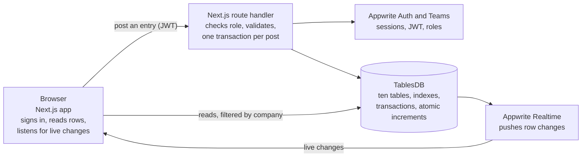

# TRD: LedgerLite (Technical Requirements)

A Next.js app reads data and listens for live changes straight from Appwrite, while every write that touches the ledger goes through a server route that validates it and commits it in one TablesDB transaction, using the signed-in user's own permissions.

## Stack

| Layer | Choice | Why |
| --- | --- | --- |
| Frontend | Next.js (App Router), TypeScript, Tailwind CSS, shadcn/ui, Recharts | Fast to build with Antigravity; good-looking by default |
| Auth and companies | Appwrite Auth (email and password) plus Teams, one team per company | Team roles give owner, accountant and viewer access for free |
| Database | Appwrite TablesDB on the shared pool | Relational columns, indexes, transactions, atomic increments; free to enter |
| Server logic | Next.js route handlers with `node-appwrite`, authenticated by the user's short-lived JWT | Appwrite permissions still apply; no admin key at runtime |
| Live updates | Appwrite Realtime subscriptions on the company's tables | Dashboard refreshes when anyone posts |
| Schema as code | `appwrite.json` pushed with `appwrite push tables` | Reproducible setup, easy for judges to read |
| Hosting (optional) | Vercel or Appwrite Sites | A live link is optional but helps the design score |

Use the current **TablesDB** API (`createRow`, `createTransaction`, `incrementRowColumn`), not the legacy Databases API, which the docs list separately.

## Architecture



Reads and live updates go straight from the browser to Appwrite. Every ledger write goes through one route handler.

## Design decisions

- **Money is stored as whole minor units** (paise or cents) in `bigint` columns. TablesDB has no decimal type, and floats cause rounding errors in books.
- **Every row carries `companyId`**, and reads filter on it. Isolation between companies comes from row permissions, not from the filter.
- **Account balances are cached** on the `accounts` table and moved with atomic increments, so the trial balance and balance sheet read one row per account. A built-in integrity check rebuilds balances from journal lines and compares them, which doubles as a demo moment.
- **Posted entries are immutable.** Journal entry and line rows get no update or delete permission; corrections are reversal entries. An entry counts as voided when a reversal entry points at it.
- **Sequential numbers** (entry numbers, invoice numbers) come from an atomic increment on a `counters` row. Gaps after a failed post are acceptable.
- **Sign rule:** an account's `balanceMinor` is total debits minus total credits. Credit-side accounts such as revenue are usually negative and are shown flipped using `normalSide`.

## How a journal entry is posted

1. The browser sends the draft (company, date, memo, lines) to `/api/journal/post` with the user's JWT.
2. The route checks the caller's team role (owner or accountant) and validates the draft: two or more lines, each line exactly one positive debit or credit, total debits equal total credits, every account exists, is active and belongs to the company.
3. It allocates the entry number with `incrementRowColumn` on the `counters` row.
4. It opens a transaction with `createTransaction`.
5. It stages, with `createOperations`: the `journalEntries` row, the `journalLines` rows, one balance `increment` or `decrement` per affected account (net debit minus credit), and one `auditLog` row.
6. It commits with `updateTransaction`. On commit, Appwrite replays the staged operations inside a real database transaction, so either everything is saved or nothing is.
7. If the commit reports a conflict (another post changed the same account), it retries up to twice with a short delay, then returns an error.
8. Realtime pushes the change to every open dashboard.

Invoices and payments use the same routine with more staged rows: an invoice stages the invoice, its items and its journal entry in one transaction.

### Sketch of the staging call

Shape taken from the Appwrite transactions docs; confirm exact field names against the docs when coding.

```ts
const tx = await tablesDB.createTransaction();

await tablesDB.createOperations({
  transactionId: tx.$id,
  operations: [
    { action: 'create', databaseId, tableId: 'journalEntries', rowId: entryId, data: entry },
    { action: 'bulkCreate', databaseId, tableId: 'journalLines', data: lines },
    { action: 'increment', databaseId, tableId: 'accounts', rowId: cashId,
      data: { value: 11800, column: 'balanceMinor' } },
    { action: 'decrement', databaseId, tableId: 'accounts', rowId: revenueId,
      data: { value: 10000, column: 'balanceMinor' } },
  ],
});

await tablesDB.updateTransaction({ transactionId: tx.$id, commit: true });
// on conflict: refetch, re-stage, retry (max 2); on other errors: rollback: true
```

## Security and permissions

- Row security is on for every table. Table-level permission only lets signed-in users create rows; real access comes from row permissions.
- Each new row gets `read` for the company team, and `update` for the owner and accountant roles only where editing is allowed (contacts, accounts, draft invoices). Ledger rows get no update or delete.
- Viewers only receive the team-wide `read`.
- The schema is created once with the CLI by you; the running app never holds an API key.
- The route handler verifies the caller's team role before staging anything.

## Reports

- Trial balance and balance sheet read cached `balanceMinor` values (one row per account).
- Profit and loss and the general ledger read `journalLines` filtered by `companyId` and `entryDate`, paginated with cursors, and are summed on the server.
- The integrity check rebuilds every account balance from `journalLines` and compares it with the cached value.

## Limits and risks

| Risk | Mitigation |
| --- | --- |
| The free plan allows 100 staged operations per transaction | Cap an entry at 20 lines and an invoice at 10 items; test the largest case |
| Concurrent posts to one account can fail the commit with a conflict | Short transactions and a two-attempt retry |
| Details not confirmed in the docs I read: Realtime channel names for TablesDB, whether a bulk operation counts as one or many against the 100 cap, relationship columns inside transactions | A 30-minute spike in the first hour; fall back to plain `varchar` foreign keys if relationships misbehave |
| Antigravity may generate legacy Appwrite SDK calls | Paste the exact TablesDB snippets from the docs into each prompt |
| 36 hours is short | Build the Must rows first and cut the Should and Stretch rows without guilt |

## Testing

- Validators are pure functions with Vitest unit tests (balanced, one-sided lines, zero amounts, inactive accounts, foreign company).
- A script posts random balanced entries and asserts the trial balance stays at zero.

## Sources

- [TablesDB overview](https://appwrite.io/docs/products/databases/tablesdb)
- [Transactions](https://appwrite.io/docs/products/databases/tablesdb/transactions)
- [Tables and column types](https://appwrite.io/docs/products/databases/tablesdb/tables)
- [Permissions](https://appwrite.io/docs/products/databases/tablesdb/permissions)
- [Atomic numeric operations](https://appwrite.io/docs/products/databases/tablesdb/atomic-numeric-operations)
