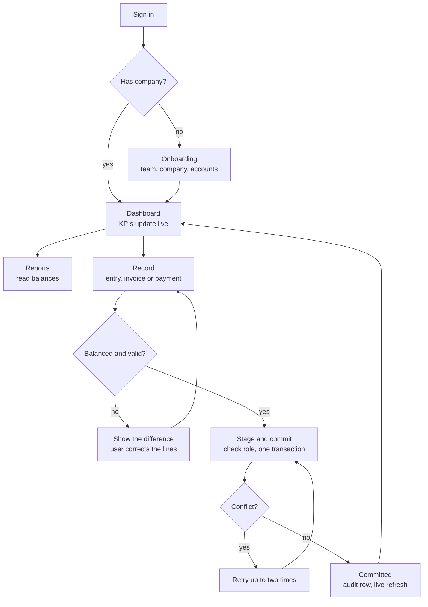

# App Flow: LedgerLite

A new user passes through onboarding once. After that, every entry, invoice or payment goes through the same gate, and a failed validation or a commit conflict loops back instead of saving anything.

Notes on the loops:

- **Left loop (user side):** an unbalanced draft never leaves the form. The difference indicator keeps the Post button disabled, and the server checks again.
- **Right loop (database side):** a conflicting commit is retried at most twice. After that the user sees an error and nothing is saved.
- Reports and the dashboard read the cached account balances, so they always agree with the last committed post.

## Journey 1: First visit

1. User opens `/login` and signs up with email and password.
2. App finds no company for the user and redirects to `/onboarding`.
3. User enters company name, currency and fiscal year start month, and optionally switches on "Load demo data".
4. Server creates, in order: the Appwrite team (the user becomes owner), the `companies` row with the same id, two `counters` rows (`entry`, `invoice`), and the 21 template accounts.
5. User lands on an empty dashboard (or a populated one if demo data was chosen).

## Journey 2: Post a manual journal entry

1. User clicks "New entry" and opens `/journal/new`.
2. User picks a date, writes a memo, and fills at least two lines (account, debit or credit).
3. The running totals update as they type. The difference indicator turns green at zero and the Post button enables.
4. User clicks Post. The browser sends the draft to `/api/journal/post` with the JWT.
5. The server runs the posting routine (see the TRD): validate, number, transaction, commit.
6. On success the user sees a toast linking to the new entry, and the dashboard updates live.
7. On a validation error the form shows the message and keeps the draft. On a conflict after retries the user sees "Please try again".

## Journey 3: Invoice and payment

1. User opens Invoices, then "New invoice", picks a customer, adds items (description, quantity, unit price, tax rate).
2. Totals compute as they type. "Save and post" sends the invoice to the server.
3. One transaction creates: the invoice, its items, a journal entry (Debit Accounts Receivable, Credit Revenue, Credit Tax Payable), and the balance changes. The invoice number comes from the `counters` table.
4. Later, the user opens the invoice and clicks "Record payment", enters amount, date, method and the receiving account.
5. One transaction creates: the payment, a journal entry (Debit Bank or Cash, Credit Accounts Receivable), increments the invoice's `paidMinor`, and sets the status to partial or paid.
6. A payment larger than the amount still owed is rejected.

## Journey 4: Void an entry

1. User opens an entry and clicks "Void".
2. Server posts a reversal entry with every line's debit and credit swapped and `reversalOfId` pointing at the original.
3. The original is never edited. It is shown as voided because a reversal points at it.
4. An audit row records who voided it and when.

## Journey 5: Reports and integrity check

1. User opens Reports and picks a tab and a date range.
2. Trial balance and balance sheet read cached balances. Profit and loss and the general ledger read journal lines for the range.
3. In Settings, "Run integrity check" rebuilds every balance from journal lines and lists any account where the cached value differs.
