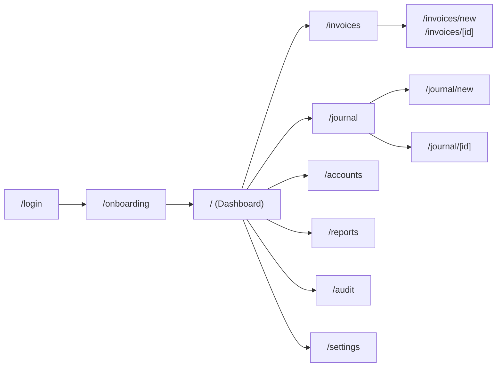

# UI Flow: LedgerLite

The app has twelve screens behind one sidebar. A new user moves from sign-in to a populated dashboard in three steps, and the two creation screens (journal entry and invoice) carry most of the design effort.

## Navigation path

Sign in, then Onboarding (company name, currency, fiscal year start, optional demo data), then Dashboard. After that the sidebar holds Dashboard, Invoices, Journal, Accounts, Reports, Audit log and Settings. A "New entry" and a "New invoice" button sit in the top bar on every page.



## Screens

| # | Screen | Route | Purpose | Key components |
| --- | --- | --- | --- | --- |
| 1 | Sign in and sign up | `/login` | Get into the app | Email and password form, toggle between modes, error messages |
| 2 | Onboarding | `/onboarding` | Create the company | Company name, currency, fiscal year start, "Load demo data" switch |
| 3 | Dashboard | `/` | Show the company's health at a glance | Four KPI cards (cash, receivables, revenue this month, expenses this month), six-month revenue vs expenses chart, recent entries list, live indicator |
| 4 | Chart of accounts | `/accounts` | Manage accounts | Accounts grouped by type with balances, add and edit dialog, deactivate toggle, "Load template" button on an empty company |
| 5 | Journal | `/journal` | Browse entries | Table with number, date, memo, amount, status chip (posted or voided), date and status filters |
| 6 | New journal entry | `/journal/new` | Record any transaction | Date, memo, line grid (account picker, debit, credit), running totals, difference indicator, Post button enabled only at zero difference |
| 7 | Entry detail | `/journal/[id]` | Inspect and correct | Lines, who posted and when, link to a reversal, "Void" button that creates the reversal |
| 8 | Invoices | `/invoices` | Track sales | List with status chips (draft, sent, partial, paid), outstanding total, search |
| 9 | Invoice editor and detail | `/invoices/new`, `/invoices/[id]` | Bill a customer and collect | Customer picker, item grid, tax rate, totals, "Save and post", "Record payment" drawer, link to its journal entry |
| 10 | Reports | `/reports` | Financial statements | Tabs for trial balance, profit and loss, balance sheet, general ledger; date range; CSV export |
| 11 | Audit log | `/audit` | Prove who did what | Append-only list with actor, action, entity and time |
| 12 | Settings | `/settings` | Company admin | Company details, members and roles, "Run integrity check", "Load demo data" |

## Key screen sketches

### New journal entry

```
+--------------------------------------------------------------+
| New journal entry                                            |
| Date [ 2026-10-31 ]   Memo [ Office rent for October      ]  |
|--------------------------------------------------------------|
| Account                        Debit        Credit           |
| [ 5200 Rent             v ]   [ 25,000.00 ] [            ]   |
| [ 1010 Bank             v ]   [           ] [ 25,000.00 ]    |
| + Add line (Enter)                                           |
|--------------------------------------------------------------|
| Total debits 25,000.00   Total credits 25,000.00             |
| Difference 0.00  (green: balanced)           [ Post entry ]  |
+--------------------------------------------------------------+
```

### Dashboard

```
+--------------------------------------------------------------+
| Dashboard                                    (live)          |
| [Cash]        [Receivables]   [Revenue MTD]   [Expenses MTD] |
| 4,82,300      1,18,000        3,40,000        1,95,500       |
|                                                              |
| Revenue vs expenses (6 months)      Recent entries           |
| [ bar chart ]                       #41 Invoice INV-0012 ... |
|                                     #40 Rent ...            |
+--------------------------------------------------------------+
```

## Design rules

- **Look:** neutral grays with one accent colour; green only for "balanced" and "paid", red only for errors and "unbalanced". Inter font with tabular numerals so columns of amounts line up, right-aligned.
- **Money display:** format from minor units with `Intl.NumberFormat` in the company currency; negative balances in parentheses.
- **Feedback:** loading skeletons, empty states with one clear action, and a toast after every post that links to the new entry.
- **Line grid:** Tab moves between cells, Enter adds a line, a debit and a credit cannot both be filled on one line.
- **Responsive:** sidebar collapses to a menu under 768 px; reports scroll horizontally.
- **Moments for the demo video:** the difference indicator turning green at zero, the dashboard updating live in a second browser window, and the integrity check reporting "all accounts match".
