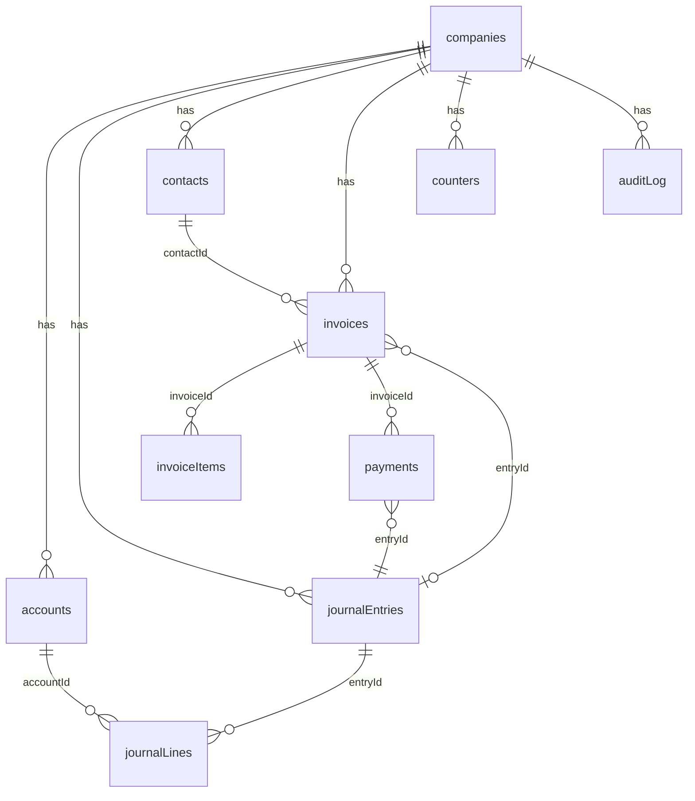

# Backend Schema: Appwrite TablesDB

One TablesDB database named `ledger` holds ten tables. Every table except `companies` has a `companyId` column, and all money columns are `bigint` minor units (paise or cents).

## Relationships



Invoice items and payments also store account ids (`accountId`, `cashAccountId`), left off the diagram for readability. Every table also stores `companyId` (omitted from the diagram except for the company links).

## Conventions

- Column types are those TablesDB supports: `varchar`, `text`, `integer`, `bigint`, `float`, `boolean`, `datetime`, `enum`, `email`. There is no decimal type, which is why money is stored as `bigint` minor units.
- Ids are Appwrite `$id` values, stored in other tables as `varchar(36)`.
- **Sign rule:** an account's `balanceMinor` is total debits minus total credits, so a credit-side account such as revenue is usually negative and is shown flipped using `normalSide`.
- Tables marked *immutable* get no update or delete permission.

## companies

The row `$id` equals the Appwrite team id.

| Column | Type | Required | Notes |
| --- | --- | --- | --- |
| name | varchar(120) | yes | Display name |
| legalName | varchar(160) | no | Printed on invoices |
| currency | varchar(3) | yes | Default `INR`; ISO code |
| fiscalYearStartMonth | integer | yes | 1 to 12, default 1 |
| taxLabel | varchar(20) | no | "GST", "VAT", default "Tax" |
| ownerId | varchar(36) | yes | Creating user |

## accounts

| Column | Type | Required | Notes |
| --- | --- | --- | --- |
| companyId | varchar(36) | yes | |
| code | varchar(10) | yes | e.g. 1100 |
| name | varchar(120) | yes | |
| type | enum | yes | asset, liability, equity, income, expense |
| normalSide | enum | yes | debit or credit |
| systemKey | varchar(30) | no | `cash`, `bank`, `ar`, `ap`, `tax_payable`, `revenue`, `expense_default`; lets invoice posting find its accounts |
| balanceMinor | bigint | yes | Default 0; changed only by atomic increment inside a posting transaction |
| isActive | boolean | yes | Default true |

Indexes: unique on (companyId, code); key on (companyId, type); fulltext on name.

## journalEntries (immutable)

| Column | Type | Required | Notes |
| --- | --- | --- | --- |
| companyId | varchar(36) | yes | |
| entryNo | bigint | yes | From the `counters` table |
| entryDate | datetime | yes | Accounting date |
| memo | varchar(500) | no | |
| source | enum | yes | manual, invoice, payment, bill, reversal, seed |
| sourceId | varchar(36) | no | Invoice or payment id |
| reversalOfId | varchar(36) | no | Set only on a reversal entry; an entry with a reversal pointing at it counts as voided |
| totalMinor | bigint | yes | Sum of debits |
| createdBy | varchar(36) | yes | |

Indexes: unique on (companyId, entryNo); key on (companyId, entryDate); key on (companyId, reversalOfId).

## journalLines (immutable)

| Column | Type | Required | Notes |
| --- | --- | --- | --- |
| companyId | varchar(36) | yes | |
| entryId | varchar(36) | yes | |
| lineNo | integer | yes | Order inside the entry |
| entryDate | datetime | yes | Copied from the entry so reports can filter by date without a join |
| accountId | varchar(36) | yes | |
| debitMinor | bigint | yes | Default 0 |
| creditMinor | bigint | yes | Default 0; exactly one of the two is above 0 |
| description | varchar(200) | no | |

Indexes: key on (entryId); key on (companyId, accountId, entryDate); key on (companyId, entryDate).

## contacts

| Column | Type | Required | Notes |
| --- | --- | --- | --- |
| companyId | varchar(36) | yes | |
| kind | enum | yes | customer or vendor |
| name | varchar(120) | yes | |
| email | email | no | |
| phone | varchar(30) | no | |
| taxId | varchar(30) | no | |

Indexes: key on (companyId, kind); fulltext on name.

## invoices

| Column | Type | Required | Notes |
| --- | --- | --- | --- |
| companyId | varchar(36) | yes | |
| kind | enum | yes | sales, or purchase for bills |
| number | varchar(30) | yes | e.g. INV-0007, from `counters` |
| contactId | varchar(36) | yes | |
| issueDate | datetime | yes | |
| dueDate | datetime | yes | |
| status | enum | yes | draft, sent, partial, paid, void |
| subtotalMinor | bigint | yes | |
| taxMinor | bigint | yes | |
| totalMinor | bigint | yes | |
| paidMinor | bigint | yes | Default 0; incremented atomically by payments |
| entryId | varchar(36) | no | The posting entry |

Indexes: unique on (companyId, kind, number); key on (companyId, status); key on (companyId, issueDate).

## invoiceItems

| Column | Type | Required | Notes |
| --- | --- | --- | --- |
| companyId | varchar(36) | yes | |
| invoiceId | varchar(36) | yes | |
| description | varchar(200) | yes | |
| quantity | float | yes | |
| unitPriceMinor | bigint | yes | |
| taxRateBp | integer | yes | Basis points: 1800 means 18% |
| lineSubtotalMinor | bigint | yes | Rounded once, on the server |
| accountId | varchar(36) | yes | Revenue or expense account |

Index: key on (invoiceId).

Optional: to show off TablesDB relationships, `invoiceId` can become a many-to-one relationship column named `invoice` with a two-way `items` key. Keep the plain column if the spike in the first hour shows problems.

## payments (immutable)

| Column | Type | Required | Notes |
| --- | --- | --- | --- |
| companyId | varchar(36) | yes | |
| invoiceId | varchar(36) | yes | |
| paymentDate | datetime | yes | |
| amountMinor | bigint | yes | Must not exceed the amount still owed |
| method | enum | yes | cash, bank, upi, card, other |
| cashAccountId | varchar(36) | yes | Account that receives the money |
| entryId | varchar(36) | yes | |
| reference | varchar(80) | no | |

Indexes: key on (invoiceId); key on (companyId, paymentDate).

## counters

| Column | Type | Required | Notes |
| --- | --- | --- | --- |
| companyId | varchar(36) | yes | |
| counterKey | varchar(30) | yes | `entry` or `invoice` |
| value | bigint | yes | Moved with `incrementRowColumn`, which returns the new value |

Index: unique on (companyId, counterKey). Created during onboarding.

## auditLog (immutable)

| Column | Type | Required | Notes |
| --- | --- | --- | --- |
| companyId | varchar(36) | yes | |
| actorId | varchar(36) | yes | |
| actorName | varchar(80) | yes | |
| action | varchar(40) | yes | e.g. `entry.posted`, `entry.voided`, `invoice.created`, `payment.recorded` |
| entityType | varchar(30) | yes | |
| entityId | varchar(36) | yes | |
| summary | varchar(300) | yes | Human-readable line |

Index: key on (companyId). Newest first uses the built-in `$createdAt`.

## Permissions

Table-level: `create` for signed-in users only, so nobody has blanket read access. Row security is **on** for all ten tables. Roles below are Appwrite team roles on the company team; the creator of a team is its owner.

| Table | Read (set on each row) | Update | Delete |
| --- | --- | --- | --- |
| companies | whole team | owner | none |
| accounts, contacts | whole team | owner, accountant | none |
| invoices | whole team | owner, accountant | none |
| invoiceItems | whole team | owner, accountant | none |
| counters | whole team | owner, accountant (increment) | none |
| journalEntries, journalLines, payments, auditLog | whole team | none | none |

A viewer holds the team membership but neither update role, so they can read everything and change nothing.

Typical row permissions when creating a row (JS SDK `Permission` and `Role` helpers):

```ts
import { Permission, Role } from 'appwrite';

const teamRead = Permission.read(Role.team(companyId));
const teamEdit = [
  Permission.update(Role.team(companyId, 'owner')),
  Permission.update(Role.team(companyId, 'accountant')),
];

// editable row (accounts, contacts, invoices, ...)
const editable = [teamRead, ...teamEdit];
// immutable row (journalEntries, journalLines, payments, auditLog)
const immutable = [teamRead];
```

## Schema as code (starter)

Create the schema with the CLI (`appwrite init tables`, then `appwrite push tables`). The `createTable` shape below comes from the Appwrite tables docs; use it as a starting point for `appwrite.json` and check exact field names against the docs.

```js
await tablesDB.createTable({
  databaseId: 'ledger',
  tableId: 'accounts',
  name: 'accounts',
  columns: [
    { key: 'companyId', type: 'varchar', size: 36, required: true },
    { key: 'code', type: 'varchar', size: 10, required: true },
    { key: 'name', type: 'varchar', size: 120, required: true },
    { key: 'type', type: 'enum', elements: ['asset', 'liability', 'equity', 'income', 'expense'], required: true },
    { key: 'normalSide', type: 'enum', elements: ['debit', 'credit'], required: true },
    { key: 'systemKey', type: 'varchar', size: 30, required: false },
    { key: 'balanceMinor', type: 'bigint', required: true },
    { key: 'isActive', type: 'boolean', required: true },
  ],
  indexes: [
    { key: 'idx_company_code', type: 'unique', attributes: ['companyId', 'code'] },
    { key: 'idx_company_type', type: 'key', attributes: ['companyId', 'type'] },
    { key: 'idx_name_fulltext', type: 'fulltext', attributes: ['name'] },
  ],
});
```

## Chart of accounts template (seed data)

About 21 accounts:

| Type | Accounts |
| --- | --- |
| Assets | 1000 Cash, 1010 Bank, 1100 Accounts Receivable, 1500 Equipment |
| Liabilities | 2000 Accounts Payable, 2100 Tax Payable, 2500 Loans Payable |
| Equity | 3000 Owner's Capital, 3100 Retained Earnings |
| Income | 4000 Sales Revenue, 4100 Service Revenue, 4900 Other Income |
| Expenses | 5000 Cost of Goods Sold, 5100 Salaries, 5200 Rent, 5300 Utilities, 5400 Software and Subscriptions, 5500 Marketing, 5600 Office Supplies, 5700 Bank Charges, 5900 Other Expense |

System keys: 1000 `cash`, 1010 `bank`, 1100 `ar`, 2000 `ap`, 2100 `tax_payable`, 4000 `revenue`, 5900 `expense_default`.

## Report formulas

- **Displayed balance:** debit-normal accounts show `balanceMinor`; credit-normal accounts show `-balanceMinor`.
- **Trial balance:** list each account's balance in the debit column if `balanceMinor > 0`, otherwise in the credit column. Total debits must equal total credits.
- **Profit and loss:** income minus expenses from journal lines within the date range.
- **Balance sheet:** assets equal liabilities plus equity plus current-period profit.
