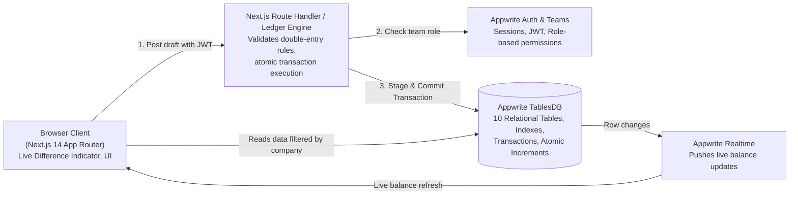
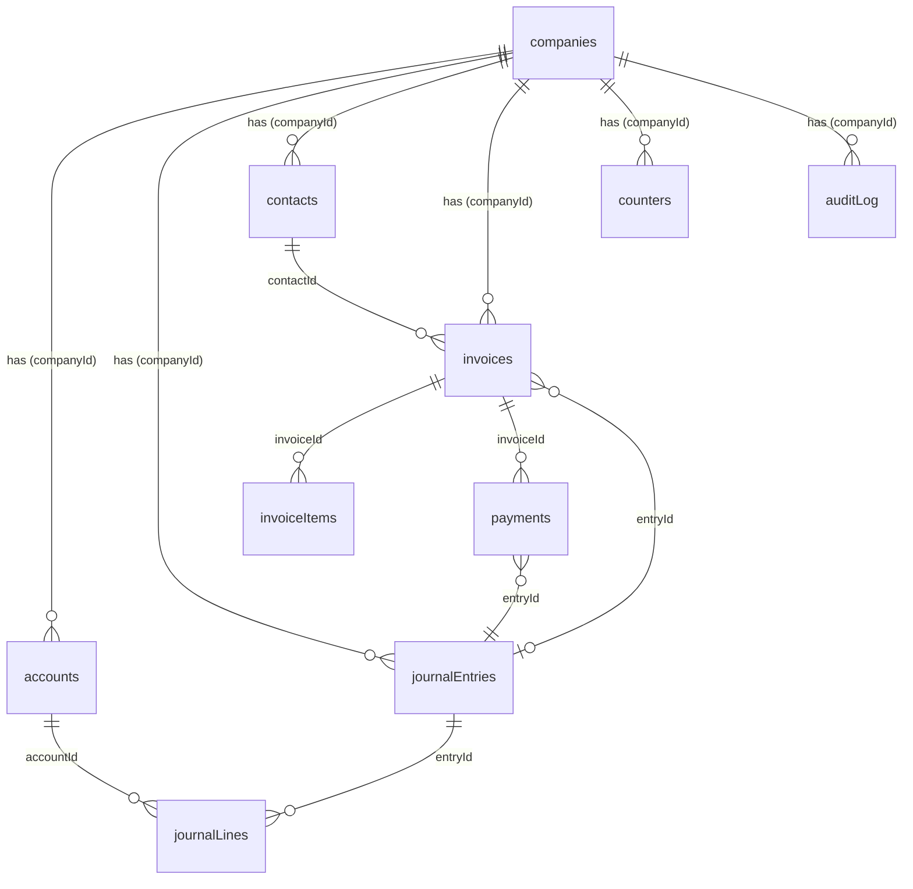

<div align="center">

# 🏛️ LedgerLite
### Double-Entry Accounting Engine Built on Appwrite TablesDB

**Books that cannot go out of balance.** Every business event becomes a balanced double-entry journal entry, committed all-or-nothing in multi-table database transactions with immutable forensic history, real-time live synchronization, and a radical Neo-Brutalist aesthetic.

---

[](https://cloud.appwrite.io)
[](https://nextjs.org/)
[](https://www.typescriptlang.org/)
[](https://tailwindcss.com/)
[](LICENSE)
[](https://github.com/SatyamPrajapati17/ledgerlite/actions)

</div>

---

## ⚡ The Problem & The LedgerLite Solution

### The Spreadsheet Dilemma
Small businesses overwhelmingly manage bookkeeping in spreadsheets. One accidental deletion, rounding slip, or typo silently breaks totals across sheets. Worse, spreadsheets lack multi-user concurrency and an immutable audit trail—anyone can alter historical numbers with zero trace.

### The LedgerLite Guarantee
LedgerLite eliminates ledger drift by encoding the fundamental laws of accounting directly into the database layer:

1. **Balanced by Construction:** A journal entry is rejected at both the UI and database layer unless $\sum \text{Debits} = \sum \text{Credits}$. The lines and account balances commit together in a single **all-or-nothing Appwrite TablesDB transaction**, or nothing is written.
2. **Atomic Balance Caching:** Account balances are updated synchronously with **Atomic Numeric Increments** (`incrementRowColumn`), eliminating race conditions during simultaneous postings.
3. **Immutable Forensic History:** Posted entries are never updated or deleted. Corrections are made via **Reversal Entries** that mirror and swap debits and credits, preserving 100% audit compliance.
4. **Live Real-Time Books:** Dashboards and reports refresh instantly across team sessions via **Appwrite Realtime** when another accountant posts an invoice or entry.
5. **Built-in Integrity Audit:** An interactive verification tool reconstructs every account balance from scratch by aggregating raw journal lines ($\text{debitMinor} - \text{creditMinor}$) and proves zero drift against cached balances.

---

## 🏗️ Architecture & Appwrite TablesDB Execution



### Deep Appwrite TablesDB Integration:
- **Multi-Table Transactions (`createTransaction`, `createOperations`, `updateTransaction`):** An invoice stages the invoice row, invoice items, and the auto-posted journal entry (Debit AR, Credit Revenue, Credit Tax Payable) in one atomic transaction.
- **Atomic Numeric Increments (`incrementRowColumn`):** Balances and sequence counters increment atomically at the database engine level with zero read-modify-write race hazards.
- **Minor-Unit Currency Storage:** All money values are strictly stored as `bigint` integers in minor units (paise or cents) to prevent IEEE 754 floating-point rounding errors.
- **Row-Level Security & Team Roles:** Built-in team permission boundaries enforce row security: **Owner** (company admin), **Accountant** (create & post), and **Auditor/Viewer** (read-only reports).
- **Composite & Fulltext Indexes:** Unique indexes on `(companyId, code)` and `(companyId, entryNo)`; key indexes on `(companyId, entryDate)`.

---

## 🎨 Neo-Brutalist Design System

LedgerLite pairs rigorous financial accounting with an unapologetic, high-contrast **Neo-Brutalist design language**:

- **Color Palette:**
  - 🔴 **Punchy Red (`#FF2A2A`):** Warnings, unbalanced states, expenses
  - 🟡 **Electric Acid Yellow (`#FFE500`):** Brand banners, primary focus elements, revenue
  - 🟢 **Emerald Green (`#00E065`):** Balanced indicators, confirmed payments, integrity match
  - ⚫ **Deep Black (`#0F0F0F`):** Structural borders, high-contrast typography
  - ⚪ **Crisp White (`#FFFFFF`):** High-clarity data cards
- **Typography Suite:**
  - **Headings & Branding:** *Italiana* & *Playfair Display* (Editorial bold serif)
  - **Body & Controls:** *Poppins* (Geometric sans-serif)
  - **Financial Data:** *JetBrains Mono* (Tabular numerals for razor-sharp column alignment)
- **Tactile Micro-Interactions:**
  - Hard offset drop shadows (`shadow-[4px_4px_0px_#000000]`)
  - Tactile physical button depressions (`active:translate-x-1 active:translate-y-1 active:shadow-none`)
  - Animated live difference indicator with color morphing and celebratory confetti on commit

---

## 🗄️ Appwrite Database Schema (10 Tables)



| Table | Primary Purpose | Immutability | Key Indexes |
|---|---|---|---|
| `companies` | Multi-tenant company workspace profile & fiscal settings | Editable | `$id` (Team ID) |
| `accounts` | Chart of accounts with cached `balanceMinor` | Protected (Atomic Only) | `(companyId, code)` [Unique], `(companyId, type)` |
| `journalEntries` | Header for double-entry records | **Immutable** | `(companyId, entryNo)` [Unique], `(companyId, entryDate)` |
| `journalLines` | Individual debit and credit line items | **Immutable** | `entryId`, `(companyId, accountId, entryDate)` |
| `contacts` | Customers and vendor directory | Editable | `(companyId, kind)` |
| `invoices` | Sales invoices with payment tracking | Editable (Drafts) | `(companyId, kind, number)` [Unique], `status` |
| `invoiceItems` | Invoice line items with tax basis points | Editable (Drafts) | `invoiceId` |
| `payments` | Customer payment receipts linked to entries | **Immutable** | `invoiceId`, `(companyId, paymentDate)` |
| `counters` | Concurrency-safe sequential numbering | Protected (Atomic Only) | `(companyId, counterKey)` [Unique] |
| `auditLog` | Append-only forensic compliance trail | **Immutable** | `companyId`, `$createdAt` |

---

## 🗺️ Application Surfaces & Screens

| Route | View | Capabilities |
|---|---|---|
| `/` | **Financial Dashboard** | 4 KPI Cards (Cash & Bank, Accounts Receivable, MTD Revenue, Operating Expenses), 6-Month Income Statement health comparison, Realtime indicator, and recent journal transactions. |
| `/journal/new` | **New Journal Entry** | Multi-line transaction grid with mutual debit/credit exclusivity, running totals, and dynamic difference indicator that locks posting until debits equal credits. |
| `/journal` | **General Journal** | Searchable audit ledger of all posted transactions, status tags (Posted, Voided, Reversal), and source badges. |
| `/journal/[id]` | **Entry Detail & Void** | Line-by-line debit/credit audit with 1-click **"Void via Reversal"** button that restores account balances without altering historical records. |
| `/invoices` | **Sales Invoices** | Receivables manager tracking payment status (Draft, Sent, Partial, Paid, Void) and outstanding balances. |
| `/invoices/new` | **Invoice Editor** | Itemized invoice builder with tax calculation that auto-posts balancing journal entries (Debit AR, Credit Revenue, Credit Tax) in one atomic transaction. |
| `/invoices/[id]` | **Invoice Detail & Payments** | Itemized breakdown with **"Record Payment"** drawer to settle outstanding invoices and auto-post Cash/Bank receipts. |
| `/accounts` | **Chart of Accounts** | 21 standard template accounts categorized into Assets, Liabilities, Equity, Revenue, and Expenses, with custom account creation and activate/deactivate toggles. |
| `/reports` | **Financial Statements** | Live financial reports: **Trial Balance** (equilibrium check), **Profit & Loss**, **Balance Sheet**, **General Ledger**, with 1-click **CSV Export**. |
| `/audit` | **Forensic Audit Log** | Append-only compliance log showing every post, reversal, invoice, payment, actor ID, and timestamp. |
| `/settings` | **Settings & Database** | Appwrite Cloud connection wizard, company preferences, demo data reset, and live **Mathematical Integrity Audit**. |

---

## 🚀 Quickstart & Setup Guide

### 1. Clone the Repository
```bash
git clone https://github.com/SatyamPrajapati17/ledgerlite.git
cd ledgerlite
npm install
```

### 2. Configure Appwrite Cloud
Create an [Appwrite Cloud](https://cloud.appwrite.io) project and set up your environment variables in `.env.local`:

```env
NEXT_PUBLIC_APPWRITE_ENDPOINT=https://nyc.cloud.appwrite.io/v1
NEXT_PUBLIC_APPWRITE_PROJECT_ID=6ae4f8d4000fe676e1aa
NEXT_PUBLIC_APPWRITE_DATABASE_ID=6ae4fc0f00271732d094
APPWRITE_API_KEY=your_appwrite_api_key_here
```

### 3. Add Web Platform in Appwrite Console
In your Appwrite project under **Platforms** $\rightarrow$ **Add Platform** $\rightarrow$ **Web App**:
- **Name:** `LedgerLite Web`
- **Hostname:** `localhost`

### 4. Push Database Schema via Appwrite CLI
```bash
npx appwrite push tables
```
*(Or run `node scripts/deploy-tables.cjs` to deploy all 10 tables, columns, and indexes via the Admin SDK).*

### 5. Run Development Server
```bash
npm run dev
```
Open **[http://localhost:3050](http://localhost:3050)** in your browser!

---

## 🧪 Testing & Verification Checks

```bash
# 1. Verify build compiles with zero errors
npm run build

# 2. Verify all 10 Appwrite TablesDB tables
node scripts/verify-tables.cjs
```

- **Mathematical Integrity Audit:** Navigate to `/settings` or click **"INTEGRITY AUDIT"** in the top bar to run a real-time scan rebuilding every balance from raw journal lines and asserting 1:1 parity with cached account balances.

---

## 📦 Complete Tech Stack & Dependencies

- **Core Framework:** [Next.js 14](https://nextjs.org/) (App Router, Server Actions, Route Handlers)
- **Language:** [TypeScript 5](https://www.typescriptlang.org/)
- **Backend & Database:** [Appwrite Web SDK (`appwrite`)](https://appwrite.io) & [Appwrite Node SDK (`node-appwrite`)](https://github.com/appwrite/sdk-for-node)
- **Styling:** [Tailwind CSS 3](https://tailwindcss.com/) & PostCSS
- **Design Guidance:** [Impeccable Design Pack (`@impeccable`)](https://impeccable.style)
- **Icons:** [Lucide React](https://lucide.dev/)
- **Motion & Animations:** [Framer Motion](https://www.framer.com/motion/)
- **Delight Effects:** [Canvas Confetti](https://www.npmjs.com/package/canvas-confetti)

---

## 🏆 Mapping to Hackathon Judging Criteria

| Criterion | Implementation in LedgerLite |
|---|---|
| **Idea & Innovation** | Books that cannot be unbalanced by construction, immutable audit trail corrected by reversal, and real-time live books. |
| **Technical Execution** | Multi-table atomic transactions with conflict retry, tested pure double-entry validators, integrity audit engine rebuilding balances from lines, schema as code in `appwrite.json`. |
| **Design & User Experience** | High-contrast Neo-Brutalism, dynamic difference indicator turning green at zero difference, tabular accounting numerals, empty states, and celebratory micro-interactions. |
| **Usage of Appwrite Databases** | TablesDB multi-table transactions (`createTransaction`, `createOperations`, `updateTransaction`), atomic numeric increments (`incrementRowColumn`), row-level security permissions, unique & fulltext indexes, and Realtime sync. |

---

## 📄 License

This project is licensed under the [MIT License](LICENSE).
